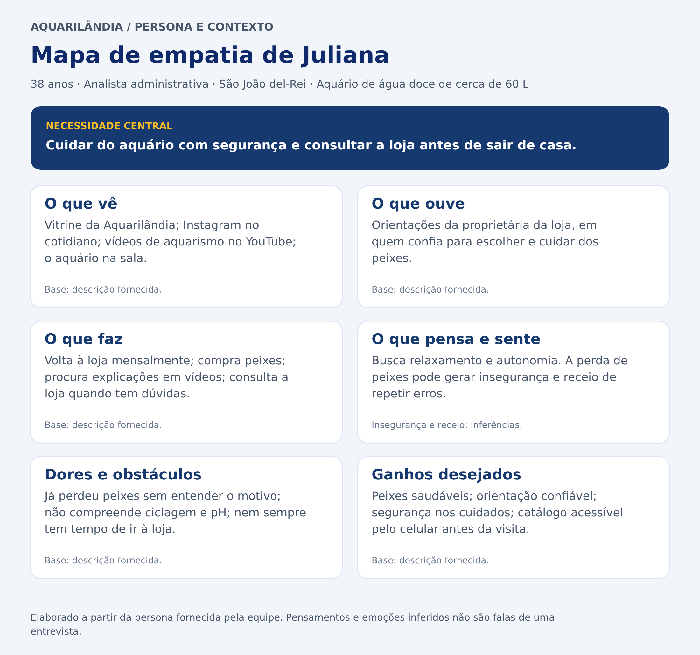
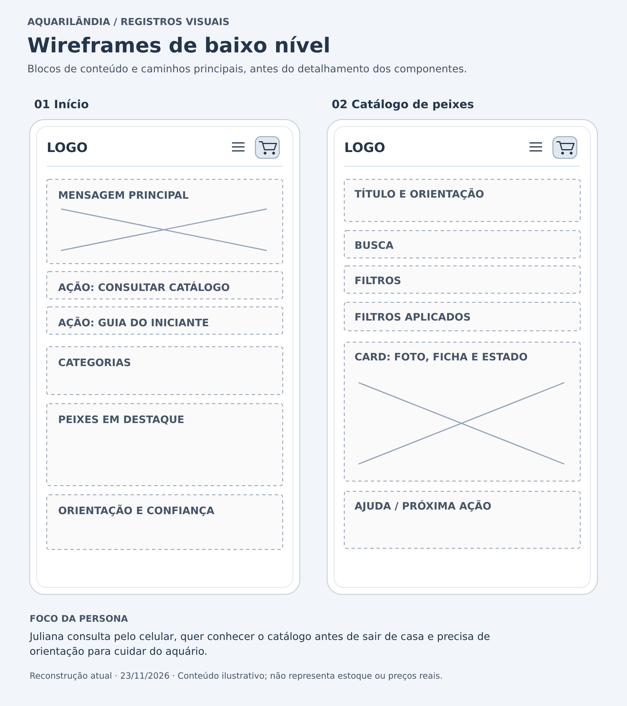
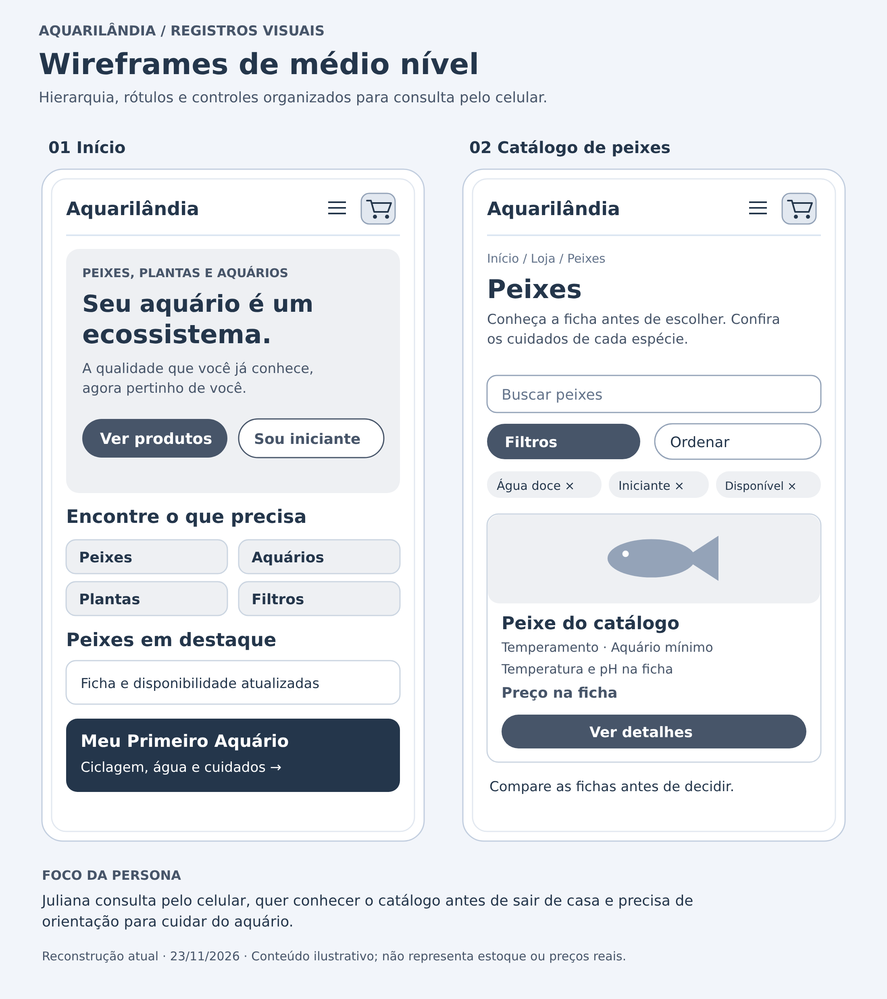
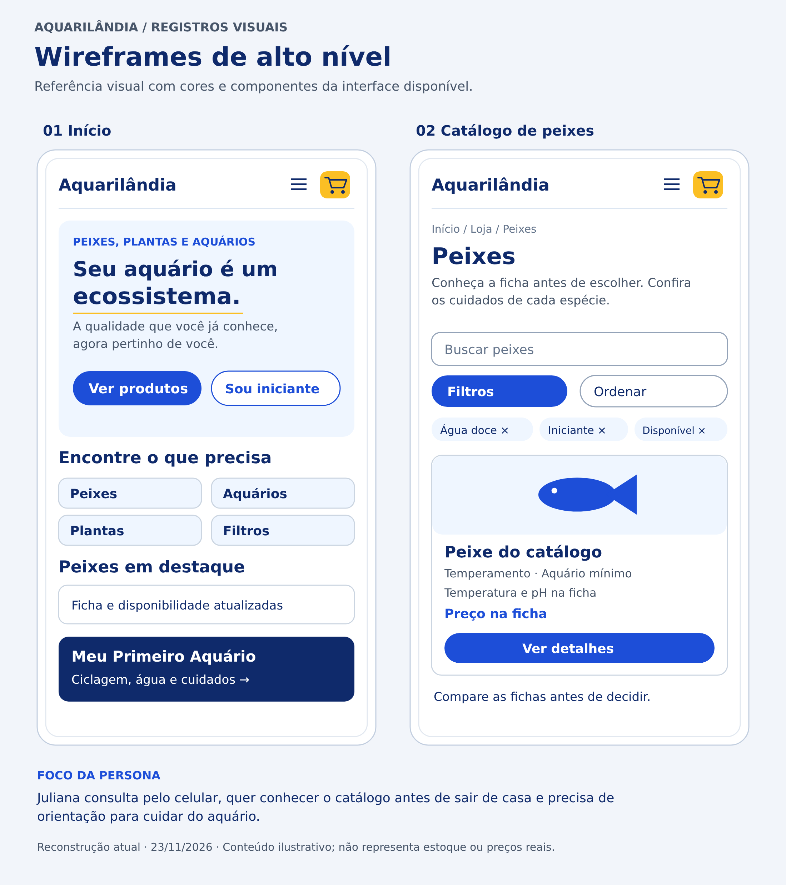
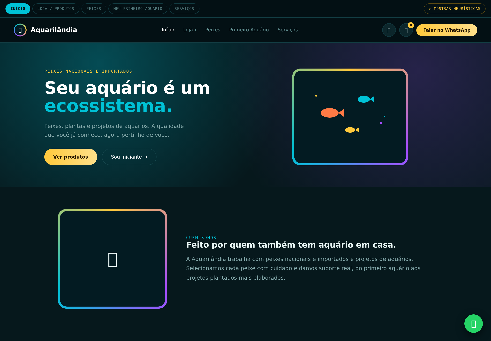

# Aquarilândia

Documentação Técnica do Projeto

CEFET-MG · Campus VIII — Varginha

Bacharelado em Sistemas de Informação · Design de Interação

Equipe: Celio Henrique Pimenta Junior · Gabriel Teixeira · Augusto Assis · Mateus Martins

Novembro de 2026 · Revisão de 23/11/2026

## 1 Introdução

O projeto Aquarilândia reúne presença digital, catálogo, orientação a iniciantes e loja virtual para um comércio de aquarismo de São João del-Rei. O relatório apresenta o problema abordado, a persona Juliana, o mapa de empatia, os registros visuais em três níveis, as decisões de design, o uso de inteligência artificial, a inspeção de usabilidade e o plano de métricas.

Os wireframes são reconstruções baseadas no projeto, datadas de 23/11/2026. A análise de interação combina leitura dos componentes da interface e dos registros de desenvolvimento. Os resultados de testes são apresentados com suas respectivas datas e versões.

A seção 8 registra a ciência e o aceite de Gerenciamento de Projetos. O Apêndice A reúne a documentação de arquitetura e implementação.

A elaboração utiliza o código-fonte e os registros de desenvolvimento do projeto (Equipe Aquarilândia, 2026a, 2026b). A apresentação segue o manual do Sistema de Bibliotecas do CEFET-MG (2025) e as orientações da ABNT NBR 14724:2024.

## 2 Parceira e problema abordado

### 2.1 Identificação da parceira

| Informação | Identificação da parceira |
| --- | --- |
| Nome comercial | Aquarilândia |
| Atividade | Comércio de peixes, plantas, aquários e equipamentos; serviços de montagem e manutenção |
| Localidade de referência | São João del-Rei, Minas Gerais |
| Atendimento | Loja física e canais de contato direto; o projeto acrescenta catálogo, conteúdo educativo e compra online |
| Interlocução relatada | Proprietária da loja, citada nas conversas e na apresentação do projeto |
| Instituição e disciplina | CEFET-MG, Campus Varginha; Bacharelado em Sistemas de Informação; Design de Interação |

### 2.2 Contexto de uso

A relação com a loja se apoia na confiança no atendimento e no conhecimento de aquarismo. Para o cliente iniciante, comprar o animal é apenas parte da tarefa: ele precisa compreender ciclagem, parâmetros da água, adequação do aquário e rotina de manutenção.

A persona fornecida pela equipe mostra uma cliente que usa intensamente o celular, visita a loja todos os meses e procura vídeos para esclarecer dúvidas. Ainda assim, depende da proprietária para decisões e nem sempre consegue ir ao estabelecimento ou receber uma resposta no momento necessário.

O projeto busca estender essa orientação para o ambiente digital, mantendo a ligação com a loja física. O atendimento continua disponível, enquanto catálogo e conteúdo ajudam a preparar a visita, comparar opções e reconhecer dúvidas que exigem orientação especializada.

### 2.3 Problema de design

Como permitir que uma pessoa iniciante, que confia na Aquarilândia mas tem pouco tempo e conhecimento técnico, consulte os produtos pelo celular e encontre orientações compreensíveis para cuidar do aquário com mais segurança?

O problema de design relaciona as necessidades da persona Juliana ao objetivo de ampliar a orientação e o atendimento digital da loja.

### 2.4 Objetivos e requisitos derivados

| Objetivo | Requisito de interface | Evidência no projeto |
| --- | --- | --- |
| Conhecer o catálogo antes da visita | Busca, filtros e disponibilidade visíveis | Loja, Peixes e serviços de catálogo |
| Apoiar a decisão de compra | Ficha de peixe, volume mínimo, temperatura e comparação | Detalhes e comparação de peixes |
| Explicar termos pouco familiares | Glossário e ajuda contextual | Componentes de termos e guia |
| Ajudar a iniciar e manter um aquário | Conteúdo organizado por etapas | Meu Primeiro Aquário e montador |
| Preservar a relação de confiança | Identidade da loja, localização e contato acessíveis | Home e canal de atendimento |
| Permitir compra e acompanhamento | Carrinho, entrega ou retirada, pagamento e histórico | Checkout e área do cliente |
| Viabilizar operação pela loja | Administração de produtos, estoque e atendimento | Painel administrativo |

### 2.5 Equipe e participação

| Integrante | Área principal registrada |
| --- | --- |
| Gabriel Teixeira | Frontend, interface e integração |
| Augusto Assis | Frontend, interface e integração |
| Celio Henrique Pimenta Junior | Backend: autenticação, clientes, vendas, pagamentos e orçamentos |
| Mateus Martins | Backend: catálogo, fichas técnicas e estoque |

## 3 Persona e mapa de empatia

### 3.1 Ficha da persona

A persona Juliana representa uma cliente iniciante da Aquarilândia. A ficha foi organizada a partir da descrição fornecida pela equipe (Equipe Aquarilândia, 2026c).

| Campo | Caracterização |
| --- | --- |
| Nome | Juliana |
| Idade | 38 anos |
| Ocupação | Analista administrativa |
| Localidade | São João del-Rei |
| Família | Mora com o marido e a filha de 9 anos |
| Aquário | Água doce, aproximadamente 60 litros, na sala de casa |
| Motivação inicial | Achou o aquário bonito e buscava uma atividade para relaxar depois do trabalho |
| Relação familiar | A filha passa tempo observando os peixes |
| Experiência | Está aprendendo; ciclagem e pH ainda são difíceis de compreender |
| Relação com a loja | Retorna mensalmente e confia na orientação da proprietária |
| Uso digital | Usa o celular, acessa Instagram diariamente e assiste a vídeos de aquarismo no YouTube |
| Critério de compra | Prioriza peixe saudável e orientação confiável, em vez de escolher apenas pelo menor preço |
| Objetivo principal | Cuidar do aquário com autonomia e segurança |
| Objetivo de consulta | Ver o que a loja tem antes de sair de casa |
| Dificuldades | Perda de peixes sem entender o motivo, termos técnicos e falta de tempo para procurar atendimento presencial |

### 3.2 História de Juliana

Juliana tem 38 anos, trabalha como analista administrativa e mora em São João del-Rei com o marido e a filha de 9 anos. Há alguns meses, parou diante da vitrine da Aquarilândia, entrou por curiosidade e decidiu montar um aquário.

Hoje ela mantém na sala um aquário de água doce de aproximadamente 60 litros. A beleza dos peixes e a possibilidade de relaxar após o trabalho motivaram a escolha. A filha também se interessa pelo aquário e passa tempo observando os animais.

Juliana volta à loja todos os meses para comprar peixes. Mantém a preferência pela Aquarilândia porque confia nas orientações da proprietária. Sua decisão de compra não é orientada apenas por preço: saúde dos peixes e segurança na orientação têm mais peso.

Ela ainda está aprendendo. Já perdeu peixes sem compreender a causa e não domina termos como ciclagem e pH. Quando surge uma dúvida, precisa ir à loja ou enviar uma mensagem, o que nem sempre se encaixa em sua rotina.

O celular é seu principal meio de acesso digital. Ela acompanha o Instagram diariamente e procura vídeos de aquarismo no YouTube. Gostaria de conseguir cuidar do aquário sozinha, com mais segurança, e consultar o catálogo da loja antes de sair de casa.

### 3.3 Mapa de empatia

O mapa organiza o contexto, as dificuldades e os objetivos de Juliana. A coluna de base identifica as informações da persona e as interpretações de design.

| Dimensão | Síntese | Base |
| --- | --- | --- |
| Vê | Vitrine da loja, aquário em casa, Instagram no cotidiano e vídeos de aquarismo no YouTube | Descrição fornecida |
| Ouve | Orientações da proprietária da Aquarilândia | Descrição fornecida |
| Faz | Visita mensalmente a loja, compra peixes, consulta a proprietária e procura vídeos | Descrição fornecida |
| Pensa e sente | Deseja relaxamento, autonomia e segurança; a perda de peixes pode gerar insegurança e receio | Desejos expressos; insegurança e receio são inferências |
| Dores | Não entender perdas, dificuldade com termos e pouco tempo para buscar orientação | Descrição fornecida |
| Ganhos | Peixes saudáveis, orientação confiável, cuidado mais autônomo e consulta prévia do catálogo | Descrição fornecida |



Figura 1 — Mapa de empatia elaborado a partir da persona fornecida; emoções inferidas estão identificadas. Revisão de 23/11/2026.

### 3.4 Implicações para o design

| Necessidade de Juliana | Decisão de design | Cuidado necessário |
| --- | --- | --- |
| Usa o celular na rotina | Layout responsivo, filtros em painel e ações com área de toque adequada | Conferir foco, zoom e telas estreitas |
| Não compreende termos | Glossário contextual e linguagem direta | Explicações precisam ser revisadas pela loja |
| Já perdeu peixes | Guia, parâmetros, volume mínimo e comparação | A interface não deve prometer compatibilidade biológica quando faltam dados |
| Quer ver a loja antes da visita | Disponibilidade, busca e filtros | Catálogo vazio, erro e falta de estoque devem ser estados distintos |
| Confia na proprietária | Identidade local e contato para orientação | O conteúdo digital deve preservar limites e oferecer ajuda |
| Não busca apenas o menor preço | Destaque para cuidados e características | Evitar que preço ou promoção escondam exigências do animal |

## 4 Wireframes, justificativas de design e evolução

### 4.1 Escopo e identificação dos registros

Os três níveis apresentam as mesmas duas telas móveis: Início e Catálogo de peixes. Manter a tarefa e as telas permite comparar a passagem dos blocos de conteúdo para a hierarquia dos componentes e, por fim, para a linguagem visual. O foco móvel decorre do uso de celular descrito na persona.

As pranchas são reconstruções de 23/11/2026, fundamentadas em HomePage, Hero, PeixesPage, componentes de catálogo e guia de estilo. Produtos, preços e disponibilidade são ilustrativos.

A equipe definiu as três pranchas apresentadas nesta seção como os registros de baixo, médio e alto nível que integram a entrega da documentação.

### 4.2 Baixo nível

O baixo nível apresenta os espaços de navegação, mensagem principal, catálogo, orientação ao iniciante, categorias e cards. O desenho reduz cor e detalhe para tornar visível a organização da informação.

Na tela inicial, a consulta de produtos e o acesso ao guia são caminhos distintos. No catálogo, busca, filtros, estado aplicado e ficha do produto ficam reconhecíveis antes da definição de estilo.



Figura 2 — Reconstrução de baixo nível: organização de conteúdo para Início e Catálogo de peixes, em formato móvel. 23/11/2026.

### 4.3 Médio nível

O médio nível define rótulos, hierarquia, posição dos controles e agrupamento da informação. Busca, filtros ativos, ordenação e abertura da ficha ficam mais concretos, sem depender da identidade cromática final.

A ficha resumida destaca características antes de conduzir à decisão. O caminho educativo permanece visível para Juliana alternar entre procurar um produto e esclarecer uma dúvida.



Figura 3 — Reconstrução de médio nível: rótulos e componentes para os mesmos fluxos móveis. 23/11/2026.

### 4.4 Alto nível

O alto nível aplica os papéis visuais do projeto: azul para ação principal, amarelo em detalhes e atalhos persistentes, superfícies claras e hierarquia de texto. A prancha representa uma referência visual da interface disponível, com conteúdo ilustrativo.

A tela inicial mantém os caminhos “Ver produtos” e “Sou iniciante”. O catálogo explicita seleção de água, dificuldade e disponibilidade. Consultar a ficha continua necessário para examinar volume mínimo, temperatura e outros requisitos.



Figura 4 — Reconstrução de alto nível com referência na identidade visual da Aquarilândia. Estados e conteúdo são ilustrativos. 23/11/2026.

### 4.5 Evidência histórica e evolução relatada

O protótipo `docs/prototipo-v4.html` foi registrado no commit `61fca98`, de 02/10/2026. A Figura 5 apresenta sua renderização, capturada em 23/11/2026, como referência da evolução visual do projeto.



Figura 5 — Visualização do protótipo HTML v4 preservado no Git. Arquivo registrado em 02/10/2026; captura realizada em 23/11/2026.

| Período registrado | Evolução e justificativa |
| --- | --- |
| 02/10 | Protótipo HTML preservado e migração inicial para React e Tailwind |
| 16/10 | Tentativa baseada em Vertex, descartada segundo o relato por não atender à identidade pretendida |
| 16 a 19/10 | Exploração de branco, azul e neon; temas claro e escuro; consolidação de azul, branco e amarelo |
| 30/10 | Melhorias de carrinho e ambientação de água, peixes e bolhas |
| 01 a 02/11 | Conteúdo para iniciantes e reorganização das categorias |
| 09/11 | Auditoria relatada contra os 39 tópicos da Atividade 05 |
| 15 a 19/11 | Filtros, aproximação entre guia e montador, fotografias da loja e integração comercial |
| 23/11 | Reconstrução visual dos três níveis e organização do relatório a partir da persona Juliana |

O histórico reúne o relato da equipe e os relatórios versionados de desenvolvimento.

### 4.6 Justificativas de design

| Escolha | Justificativa relacionada à persona | Aplicação |
| --- | --- | --- |
| Azul, branco e amarelo | Identidade ligada ao aquarismo com hierarquia consistente de ação | Tokens do guia de estilo |
| Temas claro e escuro | Oferecer preferência visual sem alterar o significado dos componentes | Mesmos tokens com valores por tema |
| Linguagem direta | Reduzir barreira para quem não domina aquarismo | Campos, mensagens, glossário e guia |
| Informação técnica junto da escolha | Apoiar cuidado e adequação, além do preço | Fichas, comparação e avisos de montagem |
| Conteúdo por etapas | Dividir o aprendizado em tarefas menores | Meu Primeiro Aquário |
| Filtros e disponibilidade | Preparar a visita e localizar opções pelo celular | Catálogo de peixes e loja |
| Feedback de carregamento e erro | Evitar interpretar indisponibilidade da API como ausência de produtos | Skeleton, estado vazio e tentativa de recarregar |
| Fotografia e localização da loja | Preservar reconhecimento e relação com o estabelecimento físico | Home e localização |
| Movimento decorativo controlado | Ambientar o aquarismo sem competir com leitura e ações | Redução de movimento e elementos decorativos |

O guia estabelece foco visível, rótulos associados aos campos e alvos de toque de 44 × 44 px como critérios de acessibilidade da interface.

## 5 Relatório de inteligência artificial

### 5.1 Ferramentas e justificativa de uso

| Ferramenta ou recurso | Uso registrado | Justificativa |
| --- | --- | --- |
| Claude em conversa | Estudo de backend, planejamento e discussão de revisões | Organizar dúvidas, alternativas e etapas de trabalho |
| Claude Code | Apoio ao frontend e execução de solicitações de desenvolvimento, conforme o relato inicial | Trabalhar com o contexto de arquivos e tarefas delimitadas |
| Codex | Consulta ao repositório, revisão e consolidação documental | Cruzar relatos com código e contratos existentes |
| Skills UI/UX Pro Max e shadcn/ui | Recursos citados no relato de frontend | Apoiar referências visuais e consistência de componentes |

A equipe utilizou a IA para explorar alternativas, organizar tarefas e apoiar o desenvolvimento. As respostas foram revisadas conforme a identidade da loja, os contratos da API e os critérios de teste.

### 5.2 Histórico selecionado de prompts reais

A seleção reúne transcrições sobre interface, controle de acesso, privacidade e verificação técnica. A fonte de cada registro indica se o texto corresponde a um pedido ou a uma instrução proposta para a IDE.

P01 — Correção de interface móvel e navegação por teclado.

Fonte: relatório de revisão de 19/11/2026, seção 7.1, registrado como pedido sugerido.

```text
Corrija somente o reflow do cabeçalho em320 px e a exposição do item focado por
teclado na vitrine, preservando a identidade, alvos e contratos; adicione regressão de navegador, verifique320/360/390
e desktop, Tab/Shift+Tab/Escape, temas, testes/lint/build. Não altere checkout, permissões ou estoque.
```

O prompt delimita a correção do cabeçalho e do foco, preserva a identidade visual e define verificações em diferentes larguras e formas de navegação.

P02 — Controle de origem antes da autenticação administrativa.

Fonte: conversa complementar com Claude, bloco “Depois, cole na IDE”. Trata-se de uma instrução proposta naquele registro.

```text
Autorizo o orcamento.routes.ts: feche o R-06 (exigirOrigem antes da guarda nas escritas de admin), com teste "escrita de admin sem Origin → 403 sem consultar a sessão" igual aos outros. Commit "chore(orcamentos): exigirOrigem antes da guarda de admin" com as linhas de atribuição.
```

O prompt identifica o arquivo, a regra de segurança e o critério de aceite. As rotas consultadas apresentam proteção de origem antes da guarda de acesso para essas escritas, acompanhada de testes.

P03 — Teste de recuperação de senha com proteção de dados.

Fonte: mesma conversa, bloco de instruções propostas para a IDE.

```text
As variáveis EMAIL_API_KEY e EMAIL_REMETENTE agora estão no .env (confira só a presença, sem imprimir). Faça o envio de teste combinado: pelo fluxo de esqueci-senha, no banco descartável, para o e-mail dono da conta Resend. Me diga o status HTTP e o id. Não imprima o token nem o link do e-mail.
```

O prompt define o fluxo de recuperação de senha, restringe o teste a um banco descartável e protege os dados do e-mail. O histórico registra resposta HTTP 202 da rota e HTTP 200 do provedor.

P04 — Verificações e atualização do registro de revisão.

Fonte: mesma conversa, item seguinte às instruções de segurança e e-mail.

```text
typecheck, npm test, test:integration no descartável, git push sem force. Atualize o revisao-base.md: R-06 resolvido.
```

O prompt combina verificações estáticas, testes de integração em ambiente descartável e atualização do registro de revisão.

P05 — Preparação da arquitetura e segurança do backend.

Fonte: solicitação da equipe na conversa de planejamento do backend com Claude.

```text
preciso estudar para conseguir montar o backend ,oq tenho que estudar de fato para conseguir estruturar tudo muito bem e com seguranca
```

Esse pedido contextualiza a preparação técnica: HTTP, organização em camadas, SQL, transações, autenticação, autorização e testes. As respostas sugeriram alternativas; o código final confirma as escolhas efetivamente adotadas, como Express, PostgreSQL com pg, Argon2 e sessões.

A seção seguinte sintetiza as solicitações de design registradas no relato de frontend.

### 5.3 Grupos de prompts de frontend registrados em resumo

| Grupo | Finalidade relatada | Resultado ou decisão registrada |
| --- | --- | --- |
| Vertex e alternativas visuais | Explorar uma linguagem para o site | Primeira direção descartada e nova paleta escolhida |
| Temas e componentes | Consolidar aparência comum | Tokens, temas, logo e componentes compartilhados |
| Ondas e rodapé | Criar ambientação de aquário | Peixes, bolhas e interações decorativas |
| Carrinho | Tratar quantidades, remoção e feedback | Melhorias de uso e persistência |
| Guia e montador | Relacionar aprendizado e escolha de produtos | Conteúdo e montagem sob uma navegação comum |
| Filtros e categorias | Facilitar consulta e reduzir densidade | Filtros ativos e composição de categorias |
| Heurísticas | Confrontar interface e critérios acadêmicos | Auditoria relatada da Atividade 05 |
| Diagnóstico de integração | Investigar tela branca e catálogo vazio | Leitura defensiva e distinção entre erro e falta de conteúdo |

O quadro apresenta uma síntese dos objetivos e das decisões de frontend.

### 5.4 Revisão das respostas e limites

A equipe relatou uso de referências visuais, limites de escopo e verificação com lint, build e testes. Entre as decisões de revisão estão descartar uma proposta de redesign, manter a identidade da loja, corrigir dados locais incompatíveis e separar demonstração de operação real.

No backend, as escolhas consolidadas foram Express, PostgreSQL com `pg`, Argon2, sessões, AbacatePay e Resend. A revisão das sugestões considerou transações, permissões e proteção de credenciais, com resultados associados às rodadas de teste documentadas.

## 6 Inspeção de Nielsen e modelos de interação

### 6.1 Escopo e etapas de inspeção

A inspeção considera as tarefas de Juliana e a documentação da interface. Nesta revisão, foram lidos os componentes e serviços de Home, Peixes, detalhe, guia e montador. A base de implementação consultada é `50e5924`, de 19/11/2026. A análise abaixo é estática e documental, sem sessão presencial ou teste de usabilidade com participantes.

| Etapa | Procedimento e resultado |
| --- | --- |
| 1. Definir perfil e objetivos | Usar a persona Juliana e as tarefas de consultar peixes, compreender termos e preparar uma compra |
| 2. Delimitar telas | Início, catálogo, ficha de peixe, guia, carrinho e transições documentadas de checkout |
| 3. Examinar critérios | Verificar estados, linguagem, navegação, consistência, prevenção e recuperação |
| 4. Registrar evidências | Associar observações a componentes, serviços e relatórios históricos |
| 5. Classificar limitações | Distinguir problema observado no código, risco de interação e achado antigo a retestar |
| 6. Propor correções | Definir ações e critérios de aceite para os achados |
| 7. Planejar nova verificação | Repetir tarefas por teclado e celular e revisar os achados na versão de entrega |

O roteiro das dez heurísticas segue Nielsen (1994), em versão revisada em 2024.

### 6.2 Aplicação das dez heurísticas

| Heurística | Aplicação e evidência | Limite ou encaminhamento |
| --- | --- | --- |
| Visibilidade do estado | Consultas apresentam carregamento, erro, vazio e possibilidade de recarregar; filtros ativos ficam identificáveis | Conferir anúncios e duração do feedback no navegador |
| Correspondência com o mundo real | Português, moeda local, unidades e termos do aquarismo | Explicar pH e ciclagem sem pressupor conhecimento de Juliana |
| Controle e liberdade | Remover itens, limpar filtros, voltar e fechar painéis | Retestar retorno do foco e navegação em largura estreita |
| Consistência e padrões | Tokens, botões, campos e estados compartilhados | Revisar textos antigos contra o contrato atual de pagamentos |
| Prevenção de erros | Carrinho e venda revalidam dados; fichas orientam a escolha | Não prometer compatibilidade quando campos estão ausentes |
| Reconhecimento | Fichas, categorias, filtros e seleção ficam visíveis | Evitar exigir que a cliente memorize parâmetros entre páginas |
| Flexibilidade e eficiência | Busca, filtros na URL e comparação apoiam caminhos diferentes | Montador ainda limita a quantidade consultada por grupo |
| Estética e minimalismo | Hierarquia de ações e categorias reduz competição visual | Verificar decoração, contraste e legibilidade no celular |
| Diagnóstico e recuperação | Erros por campo e nova tentativa de consulta indicam próximo passo | Confirmar que falha de integração não aparece como sucesso |
| Ajuda e documentação | Guia, glossário e atendimento para dúvida específica | Conteúdo técnico precisa de revisão de domínio pela loja |

### 6.3 Achados e prioridades

A escala adotada para esta análise vai de 0 a 4: 0 sem problema identificado, 1 cosmético, 2 impacto menor, 3 impacto importante na tarefa e 4 bloqueio crítico. Os valores abaixo são priorizações analíticas desta revisão, não notas de participantes.

| Registro | Evidência e impacto | Prioridade e ação |
| --- | --- | --- |
| I01 — Limite do montador | `services/montagem.js` solicita até 100 itens por grupo, podendo omitir opções de um catálogo maior | Grau 2: percorrer todas as páginas; testar grupo com mais de 100 itens |
| I02 — Item sem ficha após falha | O mesmo serviço conserva o item de listagem se o detalhe falhar; a orientação fica incompleta | Grau 3: indicar dado técnico indisponível e não apresentar compatibilidade como confirmada |
| I03 — Parâmetros provisórios | `lib/compatibilidade.js` contém regras e suposições marcadas para revisão da loja | Grau 3: revisar parâmetros e comunicar limites antes de recomendar composições |
| H01 — Reflow e foco | Relatório de 19/11, base `e7a1589`, registrou menu cortado em 320 px e foco parcialmente oculto | Achado histórico: retestar na versão de entrega, sem presumir persistência ou correção |
| H02 — VLibras e CSP | A revisão histórica identificou indisponibilidade nessa combinação de configuração | Achado histórico: validar recurso no ambiente real antes de anunciá-lo como disponível |

### 6.4 Inspeções e evolução anteriores

O relato inicial registra uma auditoria em 09/11 comparando a interface com 39 tópicos da Atividade 05: 20 classificados como iguais, 12 com pequenas diferenças, quatro diferentes e três não verificáveis apenas pelo código. Esse ciclo orientou a revisão da interface e a organização dos artefatos de design.

O relatório técnico de 19/11 inclui as dez heurísticas e evidências de navegador da base analisada. Parte das observações se refere à integração comercial simulada daquela versão. Na base desta documentação, os serviços de conta, pedidos e frete chamam a API.

Os registros de evolução abrangem melhor organização de filtros e categorias, ajuda contextual, revalidação de carrinho e integração do frontend com o backend. As evidências de cada ciclo ficam nos documentos de referência e no anexo técnico.

### 6.5 Modelo GOMS aplicado à consulta de um peixe

GOMS organiza uma tarefa em objetivo, operações, métodos e regras de seleção. A referência metodológica é Kieras (1996). A aplicação abaixo é qualitativa e não calcula tempo previsto por KLM ou execução observada.

| Componente | Aplicação à tarefa de Juliana |
| --- | --- |
| Objetivo | Identificar um peixe do catálogo e consultar suas exigências antes de decidir |
| Operações | Abrir Peixes; selecionar água doce e dificuldade; observar disponibilidade; abrir ficha; ler volume e cuidados; comparar ou pedir orientação |
| Método por filtros | Navegar por Peixes, aplicar critérios e abrir uma ficha da lista |
| Método por busca | Se já souber o nome, usar a busca e abrir o resultado correspondente |
| Regra de seleção | Nome conhecido favorece busca; exploração de opções favorece filtros |
| Condição de encerramento | Exigências identificadas e dúvida encaminhada ou decisão adiada; adicionar ao carrinho não é obrigatório |

A decomposição mostra onde reduzir memória e passos: manter filtros, apresentar características no contexto e permitir que a cliente encontre ajuda sem refazer a busca.

### 6.6 Walkthrough cognitivo aplicado ao guia

O walkthrough examina se o próximo passo tende a ser compreensível para uma pessoa iniciante, usando objetivo, visibilidade da ação, relação entre rótulo e resultado e feedback. A base é o método apresentado por Flaherty (2022). Aqui ele é aplicado como análise documental da tarefa, sem reunião de avaliadores ou respostas de participantes.

Tarefa: Juliana quer entender ciclagem antes de comprar novos peixes.

| Passo | Objetivo, ação e análise | Verificação necessária |
| --- | --- | --- |
| Reconhecer que precisa de orientação | “Sou iniciante” é uma entrada compatível com a dúvida | Confirmar que o rótulo é percebido no celular |
| Abrir o guia | A área Meu Primeiro Aquário reúne conteúdo educativo | Confirmar que Juliana distingue Aprender de Montar o meu |
| Localizar ciclagem | O guia contém uma seção específica | Verificar leitura, âncora e posição após rolagem |
| Entender o termo | Texto e glossário explicam o conceito | Revisar clareza com iniciantes e conteúdo com a loja |
| Perceber progresso | Marcadores de leitura ajudam a retomar o conteúdo | Confirmar feedback visual e acessível |
| Tomar uma decisão | Voltar ao catálogo ou procurar orientação | Não confundir leitura da seção com domínio do assunto |

### 6.7 Critérios de acessibilidade

Os critérios de verificação abrangem larguras de 320, 360 e 390 px, temas claro e escuro, zoom, teclado, foco, rótulos e leitor de tela. Ferramentas automáticas e amostras de contraste complementam a análise de navegação.

O registro de cada achado relaciona tela, versão, ação, resultado, gravidade e evidência de verificação. Essa organização permite acompanhar a correção nas revisões seguintes.

## 7 Plano de métricas analíticas

### 7.1 Objetivo e situação

O plano acompanha três resultados: ajudar a localizar produtos, apoiar a compreensão de cuidados e permitir concluir uma compra com feedback confiável. Os indicadores e eventos constituem uma proposta de instrumentação para o acompanhamento do uso.

As metas abaixo são iniciais e devem ser revisadas após a linha de base. São critérios de planejamento, não resultados alcançados nem previsão comercial.

### 7.2 Indicadores e metas propostas

| Indicador | Definição e cálculo | Coleta e meta inicial |
| --- | --- | --- |
| Sucesso em localizar uma ficha | Pessoas que concluem a tarefa de consulta ÷ pessoas que a iniciam | Sessão de usabilidade; meta proposta de pelo menos 80% de conclusão sem ajuda |
| Tempo de consulta | Mediana entre iniciar a tarefa e abrir a ficha adequada | Sessão de usabilidade; referência inicial de até dois minutos, a revisar no piloto |
| Busca sem resultado | Buscas válidas com zero resultados ÷ buscas válidas | Evento de busca concluída; formar linha de base nas duas primeiras semanas e revisar semanalmente |
| Abertura de ficha pelo catálogo | Sessões de catálogo com abertura de ficha ÷ sessões de catálogo | Eventos de catálogo e detalhe; formar linha de base, sem meta comercial presumida |
| Progresso no guia | Sessões com etapa marcada ÷ sessões que abriram o guia | Eventos do guia; acompanhar por etapa, sem interpretar marcação como aprendizado comprovado |
| Abandono do checkout | Checkouts elegíveis sem compra confirmada na janela ÷ checkouts elegíveis iniciados | Coorte com janela de 24 h; separar cancelamento, falha e pagamento ainda pendente |
| Conversão confirmada | Compras pagas únicas ÷ sessões elegíveis de compra | Confirmação no backend; excluir Dev, testes e duplicatas; estabelecer linha de base |
| Falhas da jornada | Requisições de negócio com erro 5xx ÷ requisições de negócio | Monitoramento técnico; meta inicial de menos de 1%, com revisão por volume e criticidade |

Para denominador zero, o indicador será informado como “sem amostra”. Uma janela de 24 h não elimina estados pendentes: compras com situação financeira incerta serão destacadas e não forçadas a uma classificação de abandono ou sucesso.

### 7.3 Eventos propostos

| Evento | Momento de registro | Propriedades mínimas |
| --- | --- | --- |
| `catalog_view` | Lista carregada com sucesso | Página, categoria e quantidade de resultados |
| `search_completed` | Resposta de busca recebida | Quantidade de resultados e tamanho do termo, sem texto livre |
| `filter_applied` | Aplicação de filtro | Nome do filtro e valor de lista controlada |
| `product_view` | Detalhe carregado | ID público do produto e categoria |
| `guide_open` | Abertura do guia | Página ou etapa |
| `guide_step_marked` | Marcação de leitura | ID da etapa e estado da marcação |
| `begin_checkout` | Início da tentativa de compra | Identificador de tentativa e quantidade de itens |
| `purchase_confirmed` | Transição financeira validada pelo backend | Identificador de compra para deduplicação, método e valor em centavos |
| `business_error` | Falha de uma etapa de negócio | Etapa e código de erro de lista controlada |

O evento de compra deve ter uma única ocorrência lógica por venda confirmada. Recarregar uma página, receber outro webhook ou voltar do gateway não cria uma conversão nova. Um clique em WhatsApp demonstra intenção de contato, não comprova atendimento concluído.

### 7.4 Plano de coleta e qualidade

A primeira etapa será validar os eventos em ambiente de teste com dados fictícios e identificador de ambiente. Depois, observar uma linha de base em produção, excluindo testes e equipe quando tecnicamente possível. Os eventos devem conter versão e instante para interpretar mudanças após uma atualização.

Antes de comparar períodos, conferir duplicatas, eventos ausentes, denominadores, diferenças entre dispositivo e intervalo observado. A análise de conversão precisa considerar entrega indisponível, sessão expirada, indisponibilidade do fornecedor e catálogo sem estoque.

O registro da instrumentação deve identificar a ferramenta, o armazenamento e a versão dos eventos usados na coleta.

### 7.5 Privacidade e minimização

Eventos analíticos não devem carregar nome, e-mail, telefone, endereço, CEP completo, senha, token, segredo de webhook ou texto livre de busca. IDs técnicos destinados à deduplicação devem ter acesso e uso limitados à finalidade definida.

O planejamento da coleta inclui finalidade dos identificadores, consentimento quando aplicável, prazo de retenção e permissões de acesso aos dados.

### 7.6 Responsáveis e rotina de decisão

| Atividade | Responsabilidade proposta | Frequência |
| --- | --- | --- |
| Eventos de navegação e guia | Frente de frontend | Validar a cada mudança relevante |
| Confirmação de compra e falhas | Frente de backend | Monitoramento contínuo e resumo semanal |
| Revisão de busca e conteúdo | Equipe do projeto com atendimento da loja | Semanal na fase inicial |
| Interpretação de usabilidade | Equipe de Design de Interação | Após cada rodada de tarefas |
| Revisão de metas e continuidade | Equipe do projeto e responsável da parceira | Ao final do primeiro mês de coleta |

As mudanças de interface devem ser comparadas em períodos equivalentes, considerando as taxas de conclusão, os erros e a adequação das escolhas às necessidades do usuário.

## 8 Ciência e aceite de Gerenciamento de Projetos

### 8.1 Registro de ciência e aceite

A documentação do projeto Aquarilândia foi vista e aceita pelo gerenciador de projetos, conforme confirmação fornecida pela equipe responsável pelo projeto. Esse aceite passa a integrar o registro documental desta revisão.

### 8.2 Identificação do registro

| Campo | Registro disponível |
| --- | --- |
| Projeto avaliado | Aquarilândia — site e loja virtual |
| Material referido | Documentação do projeto |
| Responsável pela ciência e pelo aceite | Gerenciador de projetos |
| Situação informada | Vista e aceita pelo gerenciador de projetos |
| Origem da informação | Confirmação fornecida pela equipe do projeto nesta revisão documental |
| Data do registro nesta revisão | 23 de novembro de 2026 |

## 9 Síntese do projeto

### 9.1 Resultados de implementação

O frontend usa React, Vite, React Router, Tailwind e componentes compartilhados. Contextos e hooks organizam estado e comportamento; serviços concentram a comunicação HTTP. O backend usa Node.js, TypeScript, Express e PostgreSQL com `pg`, separado em rotas, controllers, services e repositórios.

O catálogo possui categorias, produtos e onze tipos de ficha. Autenticação usa Argon2 e sessões. Vendas validam preço, estoque e intenção da compra no servidor; estoque possui movimentos e repetição idempotente. Pix e checkout de cartão se integram à AbacatePay; e-mail usa Resend. Logística, embalagem, retirada e frete têm contratos próprios.

A documentação de arquitetura, schema, API, segurança, estoque, pagamentos, imagens, testes e implantação está no [Apêndice A](#anexotecnico). Os relatórios de `backend/docs` e `frontend/docs` registram a evolução de cada módulo.

### 9.2 Condições de operação

A operação comercial utiliza a conta recebedora da loja, os métodos de pagamento habilitados, as tarifas de transporte aprovadas e as políticas de atendimento. O conteúdo sobre cuidados de aquarismo requer revisão da loja. Ambientes Dev são destinados às demonstrações e aos testes de integração, conforme os procedimentos do Apêndice A.

### 9.3 Organização dos entregáveis

| Artefato | Local neste relatório | Conteúdo |
| --- | --- | --- |
| Identificação da parceira e problema | seção 2 | Incluídos nome comercial, atividade, localidade, contexto da parceria e problema abordado |
| Persona e mapa de empatia | seção 3 e Figura 1 | Incluídos a partir da persona recebida |
| Registros visuais dos três níveis | seção 4 e Figuras 2 a 4 | Incluídos e definidos pela equipe para a entrega; identificados como reconstruções atuais |
| Relatório de IA | seção 5 | Ferramentas, justificativas, prompts reais selecionados e histórico resumido incluídos |
| Nielsen e modelos de interação | seção 6 | Inspeção documental, achados e aplicação qualitativa de GOMS e walkthrough incluídos |
| Plano de métricas analíticas | seção 7 | Incluído como proposta de instrumentação e acompanhamento |
| Registro de ciência e aceite | seção 8 | Documentação vista e aceita pelo gerenciador de projetos, conforme confirmação da equipe |
| Documento consolidado | Relatório e Apêndice A | Conteúdo acadêmico e técnico reunido em PDF com apresentação ABNT |

### 9.4 Conclusão

A documentação relaciona as necessidades da parceira e da persona Juliana às decisões de interface, aos registros visuais, à inspeção e ao acompanhamento proposto. A organização por tarefas evidencia que consultar um peixe envolve mais do que comparar preços: é necessário compreender cuidados, disponibilidade e adequação ao aquário. A revisão também distingue reconstruções atuais de evidências históricas e separa implementação técnica de validação em produção.

O relatório integra o contexto da parceira, os artefatos de design e a implementação técnica. A persona orienta os caminhos de consulta e aprendizado, enquanto a inspeção identifica oportunidades de melhoria. O plano de métricas oferece critérios para acompanhar a experiência de uso e orientar a evolução do site.

## Referências

ASSOCIAÇÃO BRASILEIRA DE NORMAS TÉCNICAS. **ABNT NBR 14724:2024: informação e documentação — trabalhos acadêmicos — apresentação**. Rio de Janeiro: ABNT, 2024. Disponível em: [https://www.ccs.ufpb.br/coordfarm/wp-content/uploads/sites/21/sites/454/2026/03/ABNT_NBR_14724_2024-1.pdf](https://www.ccs.ufpb.br/coordfarm/wp-content/uploads/sites/21/sites/454/2026/03/ABNT_NBR_14724_2024-1.pdf). Acesso em: 23 nov. 2026.

CENTRO FEDERAL DE EDUCAÇÃO TECNOLÓGICA DE MINAS GERAIS. Sistema de Bibliotecas. **Manual de normalização de trabalhos acadêmicos**. 3. ed. Belo Horizonte: CEFET-MG, 2025. Disponível em: [https://repositorio.cefetmg.br/server/api/core/bitstreams/dcc67c14-b1bc-4820-8c7c-b5111fc07bc6/content](https://repositorio.cefetmg.br/server/api/core/bitstreams/dcc67c14-b1bc-4820-8c7c-b5111fc07bc6/content). Acesso em: 23 nov. 2026.

EQUIPE AQUARILÂNDIA. **Aquarilândia: código-fonte e documentação técnica do projeto**. São João del-Rei, 2026a. Repositório indicado pela equipe: [https://github.com/Kmt735/Aquarilandia](https://github.com/Kmt735/Aquarilandia). Base de código consultada localmente: commit 50e5924, de 19 nov. 2026. Acesso em: 23 nov. 2026.

EQUIPE AQUARILÂNDIA. **Aquarilândia: documentação inicial do projeto e registros de desenvolvimento**. São João del-Rei, 2026b. Material fornecido à revisão documental: relato de frontend, conversa de planejamento de backend e critérios da atividade. Documento de circulação interna.

EQUIPE AQUARILÂNDIA. **Ficha de persona Juliana**. São João del-Rei, 2026c. Descrição textual fornecida pela equipe em 23 nov. 2026. Documento de circulação interna.

FLAHERTY, Kim. **Evaluate interface learnability with cognitive walkthroughs**. Nielsen Norman Group, 13 fev. 2022. Disponível em: [https://www.nngroup.com/articles/cognitive-walkthroughs/](https://www.nngroup.com/articles/cognitive-walkthroughs/). Acesso em: 23 nov. 2026.

KIERAS, David. **A guide to GOMS model usability evaluation using NGOMSL**. Ann Arbor: University of Michigan, 1996. Disponível em: [https://web.eecs.umich.edu/~kieras/docs/GOMS/NGOMSL_Guide.pdf](https://web.eecs.umich.edu/~kieras/docs/GOMS/NGOMSL_Guide.pdf). Acesso em: 23 nov. 2026.

NIELSEN, Jakob. **10 usability heuristics for user interface design**. Nielsen Norman Group, 24 abr. 1994. Revisado em 30 jan. 2024. Disponível em: [https://www.nngroup.com/articles/ten-usability-heuristics/](https://www.nngroup.com/articles/ten-usability-heuristics/). Acesso em: 23 nov. 2026.
